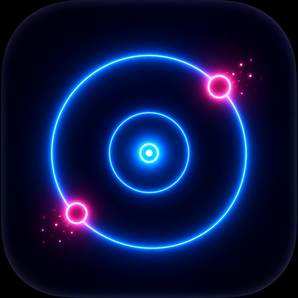
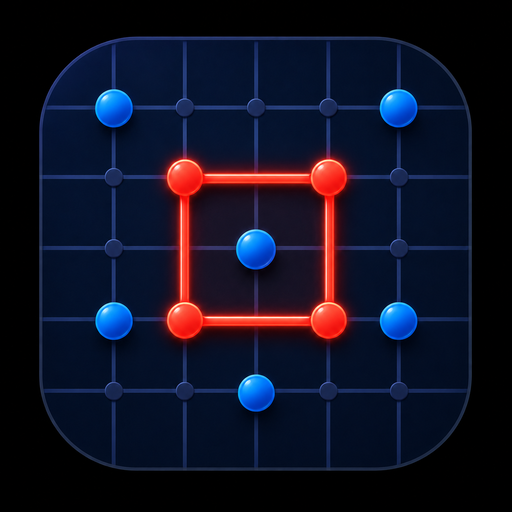
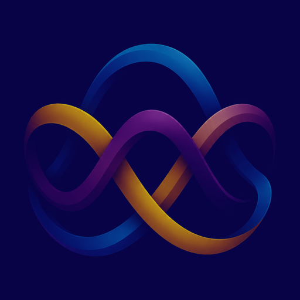
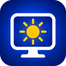
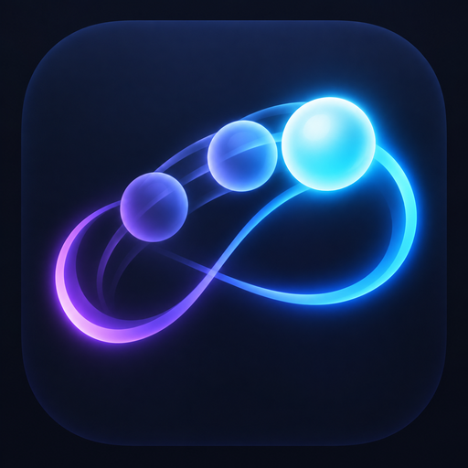
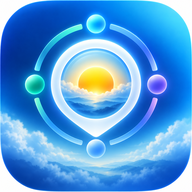
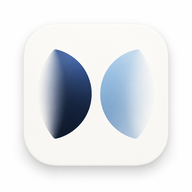
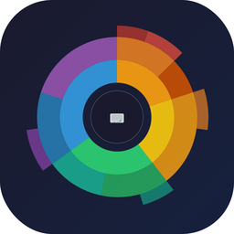

  
  <h1>Stanley Lloyd</h1>
  
<strong>Apps & Games</strong>

  
Focused software. Games with ideas.

  
<strong>Language</strong>

  

    
    &nbsp;&nbsp;
    
  

  

    <a href="https://stanleyll0yd.github.io/">Website</a>
    ·
    <a href="./SECURITY.md">Security</a>
  

---

I build compact products with clear interfaces, deliberate mechanics and as little unnecessary complexity as possible.

## Released products

| | Product | Platform | Focus |
|---|---|---|---|
|  | **[IMPULSE](https://stanleyll0yd.github.io/apps/impulse/)** | Android | Original one-tap chain-reaction game |
|  | **[Infinite Five](https://stanleyll0yd.github.io/apps/infinite-five/)** | Web / Native | Five in a row on an effectively infinite board |
|  | **[Dots](https://stanleyll0yd.github.io/apps/dots/)** | Web / Native | Stable cross-platform classic territory game with a shared Rust core |
|  | **[Password Generator](https://stanleyll0yd.github.io/apps/password-generator/)** | Android / Windows / macOS | Offline native password generation and strength analysis |
|  | **[My Cycle](https://stanleyll0yd.github.io/apps/my-cycle/)** | Android | Private local-first cycle diary with explainable estimates and local reporting |
|  | **[Biorhythms](https://stanleyll0yd.github.io/apps/biorhythms/)** | Android | Classic cycles, interactive chart and widget |
|  | **[Everon](https://stanleyll0yd.github.io/apps/everon/)** | Windows x64 | Lightweight keep-awake tray utility |
|  | **[Refresh All Tabs](https://stanleyll0yd.github.io/apps/refresh-all-tabs/)** | Chrome / Edge / Chromium | Released v1.9 browser extension with four refresh modes, timers and website exclusions; [official GitHub ZIP](https://github.com/StanleyLl0yd/RefreshAllTabs/releases/tag/v1.9), installed via Developer mode |

## In development

| | Project | Platform | Status |
|---|---|---|---|
|  | **[RERUNA](https://github.com/StanleyLl0yd/reruna)** | Android / Kotlin / Compose | R1 pre-alpha |
|  | **[MeteoOne](https://github.com/StanleyLl0yd/meteoone)** | Android / Kotlin / Compose | M1–M4 complete · [signed 0.4.1 diagnostic GitHub test release](https://github.com/StanleyLl0yd/meteoone/releases/tag/v0.4.1) · manual, privacy-safe on-device reporting · independent physical ARM64 device acceptance pending · no proprietary backend |
|  | **[Kenato](https://github.com/StanleyLl0yd/kenato)** | Android / Kotlin / Go | M4.5 accepted on two devices · signed 0.0.4 published · M5 Voice Core active; calls not yet a released feature |
|  | **[AutoBook](https://github.com/StanleyLl0yd/autobook)** | Android / Flutter | Active development |
|  | **[DiskUsage](https://github.com/StanleyLl0yd/disk-usage)** | macOS / SwiftUI | R1–R7 complete · [unsigned 0.2.1 GitHub test release](https://github.com/StanleyLl0yd/disk-usage/releases/tag/v0.2.1) published (universal ZIP + DMG, macOS 14+) · real-Mac acceptance and notarization pending |
|  | **[Window Tidy](https://github.com/StanleyLl0yd/WindowTidy)** | Windows 10/11 / C++20 / Win32 | [0.1.1 released](https://github.com/StanleyLl0yd/WindowTidy/releases/tag/v0.1.1) · portable unsigned EXE · native RU/EN interface · core actions verified, full Windows 10/11 acceptance pending |
|  | **[What Fits?](https://github.com/StanleyLl0yd/what-fits)** | Android | Prototype |
|  | **WatchRelay** | Android / Android TV | MVP development |

| BE | **[BestShot](https://github.com/StanleyLl0yd/bestshot)** | macOS / Android | Native offline photo-series selector; experimental prototypes, hardware acceptance pending |
| CO | **[CopyFix](https://github.com/StanleyLl0yd/copyfix)** | Windows / C++20 / Win32 | Portable offline clipboard cleanup; 0.1.0 prototype, interactive Windows acceptance pending |
| FA | **[FairPrice](https://github.com/StanleyLl0yd/fairprice)** | Android / Kotlin / OCR | Signed 0.1.0-beta.1 GitHub test build; real-label OCR acceptance pending |
| FO | **[FootballForecast](https://github.com/StanleyLl0yd/FootballForecast)** | Web / Next.js / Python | M0 public preview; site online, historical data and trained forecasts not yet published |
| PA | **[ParkNote](https://github.com/StanleyLl0yd/parknote)** | Android / Kotlin / Compose | Offline parking-location notes; emulator tests passed, physical-device checks pending |
| PR | **[Project 77](https://github.com/StanleyLl0yd/project-77)** | Android / Unity / C# | P2 vertical-slice development; playable narrative puzzle adventure under test |
| RA | **[Rarog](https://github.com/StanleyLl0yd/rarog)** | Rust / Windows-first | Experimental independent Web engine; not yet production browser-compatible |
| ZO | **[Zorya](https://github.com/StanleyLl0yd/zorya)** | Rust / Windows-first | Experimental desktop browser built on Rarog; not ready for everyday use |

## Research and tooling

| | Project | Area | Status |
|---|---|---|---|
| TC | **[Tredecadia](https://github.com/StanleyLl0yd/tredecadia)** | Open calendar standard | Stable v1.0.0 specification, not a calendar app |
| MK | **[MORPH-KEM](https://github.com/StanleyLl0yd/morph-kem)** | Cryptographic research | Research only, no secure KEM accepted; do not use to protect data |
| PS | **[PS Toolbox](https://github.com/StanleyLl0yd/ps-toolbox)** | PowerShell | Public collection of practical admin scripts |

## Product principles

- **Clear purpose** — each product solves a focused problem.
- **Local-first where possible** — data stays on the device unless a feature genuinely requires otherwise.
- **Minimal runtime dependencies** — fewer moving parts, less unnecessary complexity.
- **Public product pages** — the portfolio remains available even when source repositories are private.

## About this site

The portfolio is a dependency-light static site built with HTML, CSS and vanilla JavaScript. Product artwork is stored locally in this repository, so the public site does not depend on application source repositories remaining public.

Security is treated as part of the product surface: the `main` branch is protected and PR-only, changes pass a dedicated static security audit and CodeQL analysis, and secret scanning with push protection is enabled for the repository.

For vulnerability reporting and security details, see **[SECURITY.md](./SECURITY.md)**.

---

  
<strong>Русская версия</strong>

  

  Stanley Lloyd · Apps & Games · EN / RU

