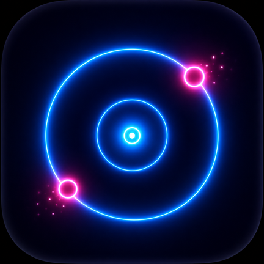
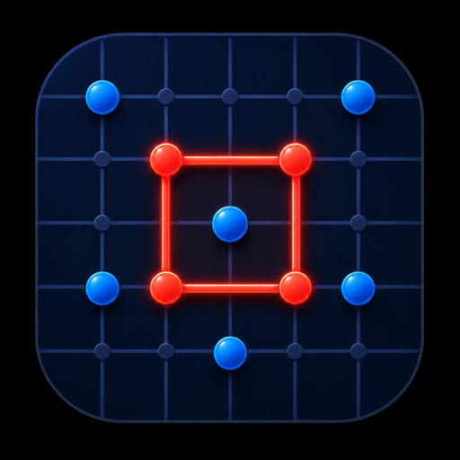
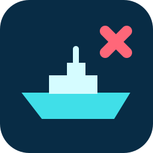
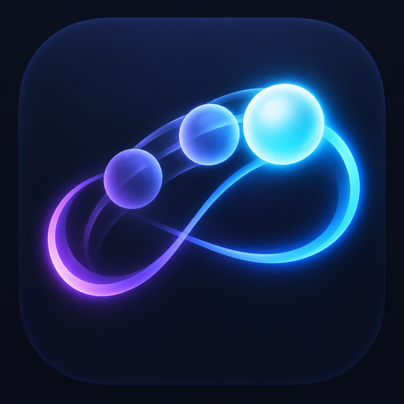
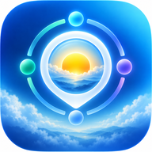
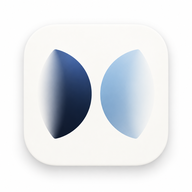
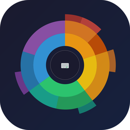

  
  <h1>Stanley Lloyd</h1>
  
<strong>Apps & Games</strong>

  
Продуманные приложения. Игры с характером.

  
<strong>Язык</strong>

  

    
    &nbsp;&nbsp;
    
  

  

    <a href="https://stanleyll0yd.github.io/">Сайт</a>
    ·
    <a href="./SECURITY.md">Безопасность</a>
  

---

Я делаю компактные продукты с понятным интерфейсом, продуманной механикой и минимумом лишней сложности.

## Готовые продукты

| | Продукт | Платформа | Назначение |
|---|---|---|---|
|  | **[IMPULSE](https://stanleyll0yd.github.io/apps/impulse/)** | Android | Авторская игра о цепной реакции, управляемая одним касанием |
|  | **[Infinite Five](https://stanleyll0yd.github.io/apps/infinite-five/)** | Web / Native | Пять в ряд на практически бесконечном поле |
|  | **[Точки](https://stanleyll0yd.github.io/apps/dots/)** | Web / Native | Стабильная кроссплатформенная версия классической игры с общим Rust-ядром |
|  | **[Морской бой / SeaBattle](https://stanleyll0yd.github.io/apps/sea-battle/)** | Web / PWA | [v1.2.1](https://github.com/StanleyLl0yd/SeaBattle/releases/tag/v1.2.1) · 19 рангов ИИ · ежедневные испытания · серии из трёх боёв · офлайн после загрузки PWA |
|  | **[Password Generator](https://stanleyll0yd.github.io/apps/password-generator/)** | Android / Windows / macOS | Нативная офлайн-генерация паролей и оценка их стойкости |
|  | **[My Cycle](https://stanleyll0yd.github.io/apps/my-cycle/)** | Android | Приватный локальный дневник цикла с объяснимыми оценками и локальными отчётами |
|  | **[Biorhythms](https://stanleyll0yd.github.io/apps/biorhythms/)** | Android | Классические биоритмы, интерактивный график и виджет |
|  | **[Everon](https://stanleyll0yd.github.io/apps/everon/)** | Windows x64 | Лёгкая утилита в системном трее для предотвращения автоматического сна |
|  | **[Refresh All Tabs](https://stanleyll0yd.github.io/apps/refresh-all-tabs/)** | Chrome / Edge / Chromium | Готовое расширение v1.9 с четырьмя режимами, таймером и исключениями сайтов; [официальный ZIP на GitHub](https://github.com/StanleyLl0yd/RefreshAllTabs/releases/tag/v1.9), установка через режим разработчика |
|  | **[CopyFix](https://stanleyll0yd.github.io/apps/copyfix/)** | Windows 10/11 x64 / C++20 / Win32 | [Официальный релиз v1.2.0](https://github.com/StanleyLl0yd/copyfix/releases/tag/v1.2.0) · портативный неподписанный EXE · 3 режима, предпросмотр/отмена, настраиваемые горячие клавиши · новый светлый/тёмный интерфейс и выбор языка (система/RU/EN) · визуальная приёмка Windows 11; CI 10/10 Windows и 3/3 Clang PASS |

## В разработке

| | Проект | Платформа | Статус |
|---|---|---|---|
|  | **[RERUNA](https://github.com/StanleyLl0yd/reruna)** | Android / Kotlin / Compose | R1 · пре-альфа |
|  | **[MeteoOne](https://github.com/StanleyLl0yd/meteoone)** | Android / Kotlin / Compose | M1–M4 завершены · [подписанная диагностическая тестовая версия 0.4.1 опубликована на GitHub](https://github.com/StanleyLl0yd/meteoone/releases/tag/v0.4.1) · локальный отчёт только по запросу · ожидается приёмка на реальном ARM64-устройстве · собственного сервера нет |
|  | **[Kenato](https://github.com/StanleyLl0yd/kenato)** | Android / Kotlin / Go | M4.5 принят на двух устройствах · [подписанная 0.0.4](https://github.com/StanleyLl0yd/kenato/releases/tag/v0.0.4) опубликована · M5: список чатов, импорт QR-приглашений и разрешений на звонки из изображений, безопасный локальный отзыв разрешений · приёмка M5 впереди, звонки пока не выпущены |
|  | **[AutoBook](https://github.com/StanleyLl0yd/autobook)** | Android / Flutter | [Подписанный тестовый APK v0.1.1](https://github.com/StanleyLl0yd/autobook/releases/tag/v0.1.1) · локальная история обслуживания автомобиля · экспорт и резервное копирование пока отсутствуют, удаление приложения удаляет записи |
|  | **[DiskUsage](https://github.com/StanleyLl0yd/disk-usage)** | macOS / SwiftUI | R1–R7 завершены · [неподписанная тестовая 0.2.1 опубликована на GitHub](https://github.com/StanleyLl0yd/disk-usage/releases/tag/v0.2.1) (универсальные ZIP и DMG, macOS 14+) · приёмка на реальном Mac и нотаризация впереди |
| TM | **[TreMana](https://github.com/StanleyLl0yd/tremana)** | macOS 27+ / Apple Silicon / SwiftUI + AppKit | [Подписанный релиз v0.5.4 на GitHub](https://github.com/StanleyLl0yd/tremana/releases/tag/v0.5.4) · управление Transmission 3.00 / RPC 16 · сохранение ширины столбцов обеих таблиц, автоподгон по двойному щелчку, управление файлами и очередь загрузки · приёмка на реальном устройстве впереди |
| CO | **[Copiva](https://github.com/StanleyLl0yd/Copiva)** | macOS 26+ / SwiftUI + AppKit | M0, ранняя разработка: пока есть только собираемый каркас приложения в строке меню. История с поиском, горячая клавиша, закрепление и вставка с форматированием или без него запланированы, но ещё не реализованы. Релиза нет. |
|  | **[What Fits?](https://github.com/StanleyLl0yd/what-fits)** | Android | Прототип |

| BE | **[BestShot](https://github.com/StanleyLl0yd/bestshot)** | macOS / Android | Нативный офлайн-выбор кадров; экспериментальные прототипы, приёмка на устройствах впереди |
| FA | **[FairPrice](https://github.com/StanleyLl0yd/fairprice)** | Android / Kotlin / OCR | Подписанная тестовая бета 0.1.0-beta.1 на GitHub; качество OCR реальных ценников ещё проверяется |
| PA | **[ParkNote](https://github.com/StanleyLl0yd/parknote)** | Android / Kotlin / Compose | Офлайн-заметки о парковке; тесты эмулятора пройдены, приёмка на устройствах впереди |
|  | **[Сошлось?](https://github.com/StanleyLl0yd/it-adds-up)** | Android 8+ / Kotlin / Compose | [Тестовый APK 0.3.0-alpha.1 с подписью CI](https://github.com/StanleyLl0yd/it-adds-up/releases/tag/v0.3.0-alpha.1) · график смен, прогноз зарплаты, сверка с расчётным листком, CSV и зашифрованные резервные копии · тестовая реклама только с согласия · ранняя альфа, в магазинах не опубликована |
| PR | **[Project 77](https://github.com/StanleyLl0yd/project-77)** | Android / Unity / C# | Разработка вертикального среза P2 сюжетной игры с головоломками |
| RA | **[Rarog](https://github.com/StanleyLl0yd/rarog)** | Rust / Windows | R0–R5 завершены, R6 проверяет совместимость; экспериментальный веб-движок, не готов к повседневному использованию |
| ZO | **[Zorya](https://github.com/StanleyLl0yd/zorya)** | Rust / Windows | Z0–Z3 завершены; доступна неподписанная тестовая версия v0.1.0, не готов для повседневной работы |

## Исследования и инструменты

| | Проект | Область | Состояние |
|---|---|---|---|
| TC | **[Tredecadia](https://github.com/StanleyLl0yd/tredecadia)** | Открытый календарный стандарт | [Стабильная v1.1.0](https://github.com/StanleyLl0yd/tredecadia/releases/tag/v1.1.0): девять стабильных профилей отображения месяцев, правила календаря v1 неизменны; это стандарт, не приложение |
| MK | **[MORPH-KEM](https://github.com/StanleyLl0yd/morph-kem)** | Исследования криптографии | Только исследование, безопасный KEM не подтверждён; не использовать для защиты данных |
| PS | **[PS Toolbox](https://github.com/StanleyLl0yd/ps-toolbox)** | PowerShell | Публичная коллекция скриптов для администрирования |

## Принципы продуктов

- **Понятная задача** — каждый продукт решает конкретную проблему.
- **Локальная работа с данными там, где это возможно** — данные остаются на устройстве, если функция действительно не требует иного.
- **Минимум runtime-зависимостей** — меньше лишних компонентов и ненужной сложности.
- **Публичные страницы продуктов** — витрина остаётся доступной независимо от того, открыты ли исходные репозитории приложений.

## Об этом сайте

Портфолио — лёгкий статический сайт на HTML, CSS и vanilla JavaScript без тяжёлых зависимостей. Графика продуктов хранится локально в этом репозитории, поэтому публичный сайт не зависит от того, остаются ли исходные репозитории приложений открытыми.

Безопасность рассматривается как часть самого продукта: ветка `main` защищена и принимает изменения только через PR, изменения проходят отдельный статический security-аудит и CodeQL, а для репозитория включены Secret Scanning и Push Protection.

Для сообщений об уязвимостях и подробностей по безопасности см. **[SECURITY.md](./SECURITY.md)**.

---

  
<strong>English version</strong>

  

  Stanley Lloyd · Apps & Games · EN / RU

